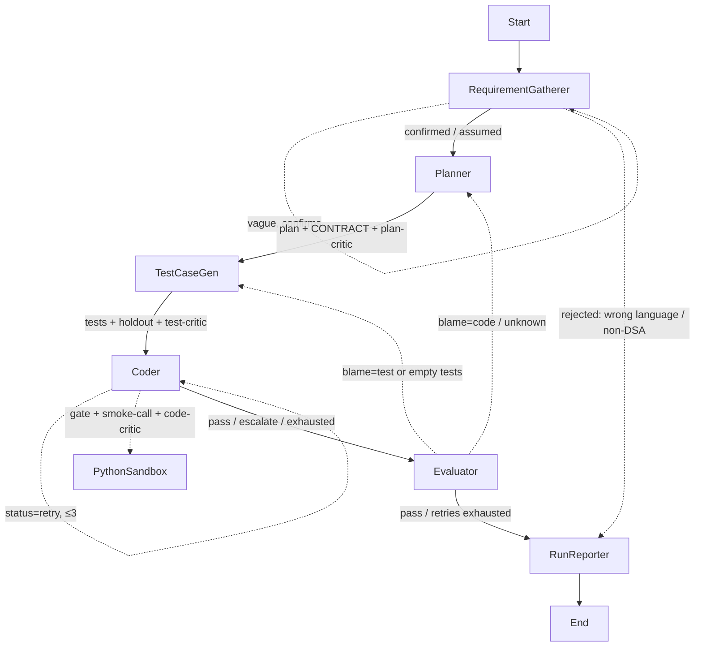

# Agent Architecture — LangGraph DSA Solver

Branch: `plan/plan.md` | Updated: 2026-10-18
Status: TDD chain (tests→coder) + coder self-loop + blame-aware evaluator + live terminal output + during-node narrator/timer + interactive/quiet gatherer modes + batch dataset driver (101 tests green).

## Goal
Terminal-driven LangGraph agent that solves data-structures & algorithms problems,
verifies with generated tests in a sandbox, retries via feedback loop, and writes
`output/run_id_xxxx.json` with requirement, code, test cases.

## Graph
`Start -> RequirementGatherer -(confirm/assume)-> Planner -> TestCaseGen -> Coder -(self-loop ≤3)-> Evaluator -(blame-aware)-> RunReporter -> End`
- Gatherer (`gather_mode` interactive/quiet): interactive prints understanding +
  assumptions + questions and confirms inline on TTY (max 2 rounds), non-TTY
  proceeds flagged `assumed`; quiet validates once (one `QUIET_GATHER_SYSTEM`
  verdict, hard gates first) and never prompts — aborting with a
  `rejection_class` (answer-changing ambiguity ⇒ strict abort), else proceed
  (`assumed` if it had to assume). Truncated input forces questions (interactive)
  / aborts `incomplete` (quiet); a model failure is `infra_error`, not a
  rejection. Quiet never re-asks (`_route_gather` short-circuits to the planner).
- Tests derive from the Planner's CONTRACT (never the Coder's code). Coder
  self-loops against the visible tests (≤3 retries, `coder_iterations`) to fix
  its own code before handing off.
- `Evaluator` re-runs the full matrix (visible + holdout) as the only gate;
  `--fail--> TestCaseGen` when the dominant blame is the test, `--fail--> Planner`
  when it is the code (max 3 iterations; mechanical smoke failure short-circuits
  with `error_class`, no matrix run), else `--> RunReporter`.
- `Coder -> guardrail.check() -> python_sandbox` tool (fail-closed; blocked never execs). Full spec: `guardrails.md`.

## Models (Ollama)
- Heavy + critic `nemotron-3-super:cloud`; testgen `nemotron-3-super:cloud` with
  `reasoning=True`; small `gemma4:31b-cloud`.
- `src/agent/llms.py`: `get_small()` temp 0 / 4096 tokens / 90s timeout,
  `get_heavy()` temp 0.2 / 180s timeout, `get_critic()` 512 tokens / 60s timeout,
  `get_testgen()` temp 0 / 4096 tokens / `reasoning` on (env `OLLAMA_TESTGEN`,
  `OLLAMA_TESTGEN_THINK`).
- Env: `OLLAMA_HEAVY`, `OLLAMA_SMALL`, `OLLAMA_TESTGEN`, `OLLAMA_BASE_URL` (default `http://localhost:11434`).

## State (`src/agent/state.py`)
`run_id, requirement, gather_mode (interactive|quiet), status (ok|assumed|aborted|infra_error),`
`rejection_class, workability{verdict,reason,assumptions[],blocking_ambiguities[],confidence,rejection_class,rubric_version}, out_dir,`
`clarified_intent, intent_iterations, intent_clear,`
`confirmed, assumed, plan_steps, function_signature, arg_spec,`
`returns_spec, test_cases, holdout_tests, code,`
`coder_smoke{stdout,stderr,error}, coder_checks (self-loop results), coder_iterations, coder_status,`
`guardrail_report{allowed,reasons[],checked_at},`
`fallback_used, critic_overruled, execution_results (replace semantics),`
`eval{passed,passed_count,total,feedback,error_class,blame}, feedback, iterations, output_path`.

## Nodes (`src/agent/nodes.py`)
1. RequirementGatherer: Python-only + DSA-scope gates (rejects → reporter);
   truncation forces user questions; **interactive** (default) TTY *always* shows
   understanding + assumptions and waits for Enter (max 2 correction rounds),
   non-TTY proceeds `assumed` when vague; **quiet** validates in one
   `QUIET_GATHER_SYSTEM` pass without prompting (abort on not-workable /
   blocking ambiguity / truncation, else proceed), `infra_error` on model
   failure (`_abort`, `_quiet_gather`, `_workability`).
   Emits `clarified_intent`, `confirmed`/`assumed`, `status`, `rejection_class`,
   `workability`.
2. Planner (heavy, small fallback): LLM plan + fenced JSON `CONTRACT`
   (signature + typed args/ranges + returns; legacy `SIGNATURE:` accepted);
   consumes `feedback` on retry; stub if both models fail.
3. TestCaseGen (testgen = heavy + `reasoning`, falls back to heavy): LLM JSON
   `[{id,harness,expected}]` (3-5, harness must `print(solve(...))` with
   contracted arity and in-range values, boundary coverage) derived from the
   planner CONTRACT + `feedback` — **never from the coder's code**; validated +
   guardrail-screened; splits off one **holdout** test (≥3 tests) the coder
   never sees; resets `coder_iterations`/`coder_status`; `[]` fallback.
4. Coder (heavy, small fallback + `python_sandbox` tool): LLM code honoring the
   planner's `function_signature` and the visible `test_cases` (AST-validated,
   repair on mismatch), mandatory guardrail gate + import smoke + `solve()`
   call-smoke (fails only on NameError/ImportError); bounded repairs (sig-fix or
   smoke-fix, then one critic regen); then a **bounded self-loop** (≤3 retries)
   running the visible tests with deterministic blame — retries on code-side
   failures, `escalate`s when all remaining failures blame the test; emits
   `code`, `coder_smoke`, `guardrail_report`, `coder_checks`, `coder_status`,
   `coder_iterations`.
5. Evaluator: re-runs every harness (visible + holdout) via gated `run_python`
   as the **only authoritative gate**; compares stdout to expected; adjudicates
   failures (`adjudicate()`: contract violations ⇒ test, else judge verdict)
   with per-result `blame`; repairs blame=test cases in place (`repair_test()`,
   escalates on flip-flop); computes dominant `eval.blame`; emits
   `execution_results` (replace semantics — latest run only; each entry carries
   `harness` for self-describing output), `eval`, `iterations`.
6. RunReporter (deterministic, no LLM): consolidate + write JSON.

Resilience: small 90s / heavy 180s / testgen 180s client timeouts; heavy→small
fallback sets `fallback_used` (planner, coder incl. repair); chain is sequential
TDD (planner→tests→coder) — testgen derives from the contract, and the coder's
self-loop never finishes a run (the evaluator re-runs the full matrix).
Critics: `critique()` on nemotron (512 tokens) reviews plan/code/tests with max 1
regen each; `critic_overruled` set when proceeding with open issues.

## CLI + Output
- `PYTHONPATH=src uv run python -m cli --problem "..." | --file p.md | stdin pipe`.
  With no args on a TTY it prompts via `input()` (blank line finishes); piped stdin still read directly.
- `run_id = run_id_YYYYMMDD_HHMMSS_<6hex>`, overridable via `--run-id`; `--out-dir` sets the output root (default `output`); `--quiet` prints status lines only, `--verbose` also dumps the full final code/tests/holdout.
- `--gather-mode {interactive,quiet}` (default: interactive on a TTY, else quiet);
  `--problems-file problems.jsonl` runs batch mode (implies quiet, mutually
  exclusive with `--problem`/`--file`).
- Batch: `output/<batch_id>/<id>.json` per row + `output/<batch_id>/summary.json`
  (`status_counts`, `rejection_class_counts`, `yield{completed,aborted,infra}`,
  `skipped`); a raising row is `infra_error` and the batch continues.
- Exit codes: `0` ok/assumed/aborted, `1` infra, `2` bad input.
- Live output: per-node status lines (`✓` done, `↻` retry+escalate, `⚠` blocked, `⛔` rejected, `(fallback)`/`(assumed)` tags), each ending with that node's duration (`· 12.4s`), plus rich panels — the planner's plan + contract (signature/args/returns), the generated code on every coder attempt, a test-case table (holdout labelled), and input/expected/actual/blame result tables for the coder self-check and the evaluator. Long values/code are clipped. While a node runs, a bottom-line spinner with rotating, node-aware phrases (`_NARRATION`) plus a live seconds counter (`planner: thinking…  (14s)`) is driven by a worker thread feeding a queue + main-thread `rich.live.Live(get_renderable=...)` (a persistent `Spinner` whose text is recomputed ~8×/s on the refresh thread; the phrase rotates every `_NARRATION_INTERVAL = 3s`). The spinner/timer shows only when panels are on and stdout is a TTY, so `--quiet`/piped runs stay clean (they still carry the duration suffix).
- JSON schema: `run_id, timestamp, models{heavy,small}, requirement, gather_mode,`
  `status, rejection_class, workability{...,rubric_version}, rejected,`
  `rejection_reason, clarified_intent, intent_iterations, intent_clear,`
  `confirmed, assumed, plan_steps, function_signature, arg_spec,`
  `returns_spec, test_cases, holdout_tests, code,`
  `coder_smoke, coder_checks, coder_iterations, guardrail_report, fallback_used,`
  `critic_overruled, execution_results, eval{...,blame}`.
- Written by RunReporter to `output/<run_id>.json` (also on exhausted retries with `passed:false`).

## Guardrails
Spec: `guardrails.md` — entry gates (Python-only language, DSA-scope, truncation
questions) + static AST gate + strict file lockdown + hardened exec, fail-closed.
Implementation: `src/agent/tools/guardrail.py`, `src/agent/errors.py`
+ `tests/test_guardrails.py`, `test_language.py`, `test_scope.py`.

## Project setup (uv)
- `pyproject.toml`: `langgraph, langchain-ollama, langchain-core, pydantic, rich`; dev `pytest, ruff`.
- Layout: `src/agent/{state,llms,prompts,nodes,graph,errors,tools/sandbox,tools/guardrail}.py`, `src/cli.py`,
  `tests/{test_graph,test_sandbox,test_intent,test_toolbox,test_guardrails,test_nodes,test_cli,test_scope,test_language,test_smoke,test_reporter,test_session}.py`, `output/.gitkeep`, `plan/`.
- Verify: `uv sync`, `PYTHONPATH=src uv run pytest -q` (101 passed),
  `PYTHONPATH=src uv run python -m cli --problem "two sum..."`.
