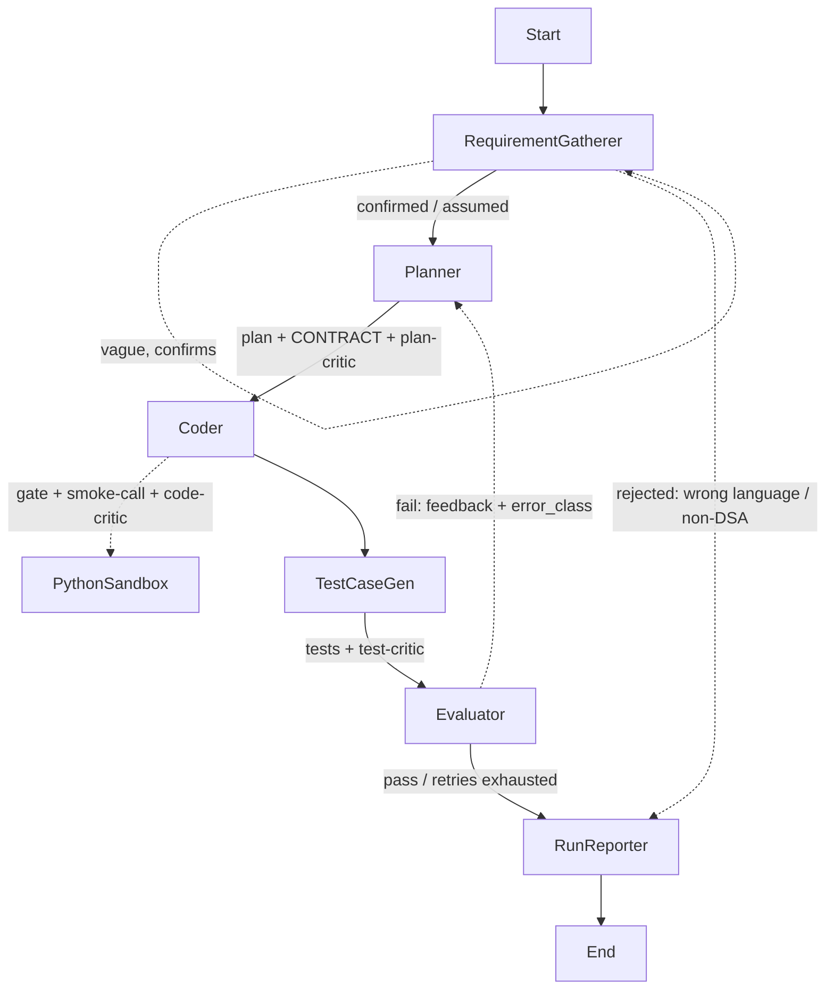

# Agent Architecture — LangGraph DSA Solver

Branch: `task/step-1-5` | Updated: 2026-10-13
Status: RequirementGatherer + critics + sequential chain + gemma-all-models (53 tests green).

## Goal
Terminal-driven LangGraph agent that solves data-structures & algorithms problems,
verifies with generated tests in a sandbox, retries via feedback loop, and writes
`output/run_id_xxxx.json` with requirement, code, test cases.

## Graph
`Start -> RequirementGatherer -(confirm/assume)-> Planner -> Coder -> TestCaseGen -> Evaluator -> RunReporter -> End`
- Gatherer prints understanding + assumptions + questions, confirms inline on TTY
  (max 2 rounds); non-TTY proceeds flagged `assumed`. Truncated input forces questions.
- `Evaluator --fail--> Planner` (max 3 iterations; mechanical smoke failure
  short-circuits with `error_class`, no matrix run), else `--> RunReporter`.
- `Coder -> guardrail.check() -> python_sandbox` tool (fail-closed; blocked never execs). Full spec: `guardrails.md`.

## Models (Ollama)
- Heavy + critic `nemotron-3-super:cloud`, small `gemma4:31b-cloud`.
- `src/agent/llms.py`: `get_small()` temp 0 / 4096 tokens / 90s timeout,
  `get_heavy()` temp 0.2 / 180s timeout, `get_critic()` 512 tokens / 60s timeout.
- Env: `OLLAMA_HEAVY`, `OLLAMA_SMALL`, `OLLAMA_BASE_URL` (default `http://localhost:11434`).

## State (`src/agent/state.py`)
`run_id, requirement, clarified_intent, intent_iterations, intent_clear,`
`confirmed, assumed, plan_steps, function_signature, arg_spec,`
`returns_spec, test_cases, code,`
`coder_smoke{stdout,stderr,error}, guardrail_report{allowed,reasons[],checked_at},`
`fallback_used, critic_overruled, execution_results (replace semantics),`
`eval{passed,passed_count,total,feedback,error_class}, feedback, iterations, output_path`.

## Nodes (`src/agent/nodes.py`)
1. RequirementGatherer: Python-only + DSA-scope gates (rejects → reporter);
   truncation forces user questions; TTY *always* shows understanding +
   assumptions and waits for Enter (max 2 correction rounds);
   non-TTY proceeds `assumed` when vague.
   Emits `clarified_intent`, `confirmed`/`assumed`.
2. Planner (heavy, small fallback): LLM plan + fenced JSON `CONTRACT`
   (signature + typed args/ranges + returns; legacy `SIGNATURE:` accepted);
   consumes `feedback` on retry; stub if both models fail.
3. TestCaseGen (small): LLM JSON `[{id,harness,expected}]` (3-5, harness must
   `print(solve(...))` with contracted arity and in-range values, boundary
   coverage); validated + guardrail-screened; `[]` fallback.
4. Coder (heavy, small fallback + `python_sandbox` tool): LLM code honoring the
   planner's `function_signature` (AST-validated, repair on mismatch),
   mandatory guardrail gate + import smoke + `solve()` call-smoke (fails only
   on NameError/ImportError); bounded repairs (sig-fix or smoke-fix, then one
   critic regen); emits `code`, `coder_smoke`, `guardrail_report`.
5. Evaluator: runs each harness via gated `run_python`, compares stdout to
   expected; adjudicates failures (`adjudicate()`: contract violations ⇒ test,
   else small-model verdict) with per-result `blame`; repairs blame=test cases
   in place (`repair_test()`, escalates on flip-flop); emits `execution_results`
   (replace semantics — latest run only), `eval` (failure details), `iterations`.
6. RunReporter (deterministic, no LLM): consolidate + write JSON.

Resilience: small 90s / heavy 180s client timeouts; heavy→small fallback sets
`fallback_used` (planner, coder incl. repair); chain is sequential
planner→coder→tests (testgen sees final code).
Critics: `critique()` on nemotron (512 tokens) reviews plan/code/tests with max 1
regen each; `critic_overruled` set when proceeding with open issues.

## CLI + Output
- `PYTHONPATH=src uv run python -m cli --problem "..." | --file p.md | stdin pipe`.
  With no args on a TTY it prompts via `input()` (blank line finishes); piped stdin still read directly.
- `run_id = run_id_YYYYMMDD_HHMMSS_<6hex>`, overridable via `--run-id`; `--verbose` prints code + tests.
- Live status: one line per node via `graph.stream` (`✓` done, `↻` retry, `⚠` blocked, `⛔` rejected, `(fallback)`/`(assumed)` tags).
- JSON schema: `run_id, timestamp, models{heavy,small}, requirement, rejected,`
  `rejection_reason, clarified_intent, intent_iterations, intent_clear,`
  `confirmed, assumed, plan_steps, function_signature, arg_spec,`
  `returns_spec, test_cases, code,`
  `coder_smoke, guardrail_report, fallback_used, critic_overruled, execution_results, eval`.
- Written by RunReporter to `output/<run_id>.json` (also on exhausted retries with `passed:false`).

## Guardrails
Spec: `guardrails.md` — entry gates (Python-only language, DSA-scope, truncation
questions) + static AST gate + strict file lockdown + hardened exec, fail-closed.
Implementation: `src/agent/tools/guardrail.py`, `src/agent/errors.py`
+ `tests/test_guardrails.py`, `test_language.py`, `test_scope.py`.

## Project setup (uv)
- `pyproject.toml`: `langgraph, langchain-ollama, langchain-core, pydantic, rich`; dev `pytest, ruff`.
- Layout: `src/agent/{state,llms,prompts,nodes,graph,errors,tools/sandbox,tools/guardrail}.py`, `src/cli.py`,
  `tests/{test_graph,test_sandbox,test_intent,test_toolbox,test_guardrails,test_nodes,test_cli,test_scope,test_language,test_smoke,test_reporter,test_session}.py`, `output/.gitkeep`, `plan/`.
- Verify: `uv sync`, `PYTHONPATH=src uv run pytest -q` (53 passed),
  `PYTHONPATH=src uv run python -m cli --problem "two sum..."`.
