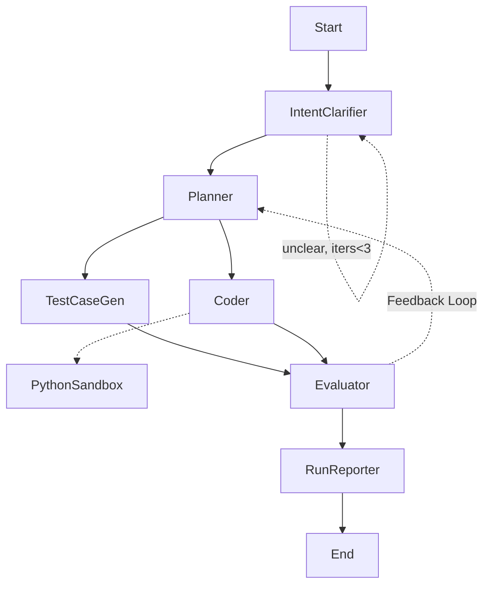

# Agent Architecture — LangGraph DSA Solver

Branch: `task/initial-plan` | Updated: 2026-10-13
Status: scaffold + stubs implemented, 7 tests passing. LLM prompts + guardrails pending (see `guardrails.md`, `plans.md`).

## Goal
Terminal-driven LangGraph agent that solves data-structures & algorithms problems,
verifies with generated tests in a sandbox, retries via feedback loop, and writes
`output/run_id_xxxx.json` with requirement, code, test cases.

## Graph
`Start -> IntentClarifier -(self-loop max 3)-> Planner -> [TestCaseGen, Coder] -> Evaluator -> RunReporter -> End`
- `IntentClarifier --unclear & iters<3--> IntentClarifier`, else `--> Planner` (proceeds with assumptions after 3).
- `Evaluator --fail--> Planner` (max 3 iterations), else `--> RunReporter`.
- `Coder -> guardrail.check() -> python_sandbox` tool (fail-closed; blocked never execs). Full spec: `guardrails.md`.

## Models (Ollama)
- Heavy `gemma4:31b-cloud` (verified via `ollama list`): Planner, Coder, Evaluator.
- Small `deepseek-r1:1.5b` (local 1.1GB): IntentClarifier, TestCaseGen.
- `src/agent/llms.py`: `get_small()` temp 0, `get_heavy()` temp 0.2.
- Env: `OLLAMA_HEAVY`, `OLLAMA_SMALL`, `OLLAMA_BASE_URL` (default `http://localhost:11434`).

## State (`src/agent/state.py`)
`run_id, requirement, clarified_intent, intent_iterations, intent_clear,`
`plan_steps, test_cases, code, coder_smoke{stdout,stderr,error},`
`guardrail_report{allowed,reasons[],checked_at},`
`execution_results (+add reducer), eval{passed,passed_count,total,feedback},`
`feedback, iterations, output_path`.

## Nodes (`src/agent/nodes.py`)
1. IntentClarifier (small, self-loop max 3): normalize statement; `is_intent_clear()`
   heuristic (len>=30 + keyword) now, small-LLM rewrite later; emits
   `intent_iterations`, `intent_clear`; router exits to Planner when clear or iters>=3.
2. Planner (heavy): algo + complexity + steps; consumes `feedback` on retry.
3. TestCaseGen (small): base + edge cases as `{id,input,expected}` (stub).
4. Coder (heavy + `python_sandbox` tool): generate code, then mandatory guardrail
   gate (`guardrail.check()` — AST allowlist, file read/write denied, fail-closed)
   then verify via toolbox (`run_python(code, harness)`); smoke + `guardrail_report`
   stored in state/output. Full path: `get_heavy().bind_tools([python_toolbox])`.
5. Evaluator (heavy): run code vs tests, emit `eval` + `feedback` (stub matrix).
6. RunReporter (deterministic, no LLM): consolidate + write JSON.

## CLI + Output
- `PYTHONPATH=src uv run python -m cli --problem "..." | --file p.md | stdin`.
- `run_id = run_id_YYYYMMDD_HHMMSS_<6hex>`, overridable via `--run-id`.
- JSON schema: `run_id, timestamp, models{heavy,small}, requirement, clarified_intent,`
  `intent_iterations, intent_clear, plan_steps, test_cases, code, coder_smoke,`
  `guardrail_report, execution_results, eval`.
- Written by RunReporter to `output/<run_id>.json` (also on exhausted retries with `passed:false`).

## Guardrails
Spec: `guardrails.md` (static AST gate + strict file lockdown + hardened exec,
fail-closed). Implementation: `src/agent/tools/guardrail.py` + `tests/test_guardrails.py` (see `plans.md` Step 5).

## Project setup (uv)
- `pyproject.toml`: `langgraph, langchain-ollama, langchain-core, pydantic, rich`; dev `pytest, ruff`.
- Layout: `src/agent/{state,llms,nodes,graph,tools/sandbox,tools/guardrail}.py`, `src/cli.py`,
  `tests/{test_graph,test_sandbox,test_intent,test_toolbox,test_guardrails}.py`, `output/.gitkeep`, `plan/`.
- Verify: `uv sync`, `PYTHONPATH=src uv run pytest -q` (7 passed),
  `PYTHONPATH=src uv run python -m cli --problem "two sum..."`.
