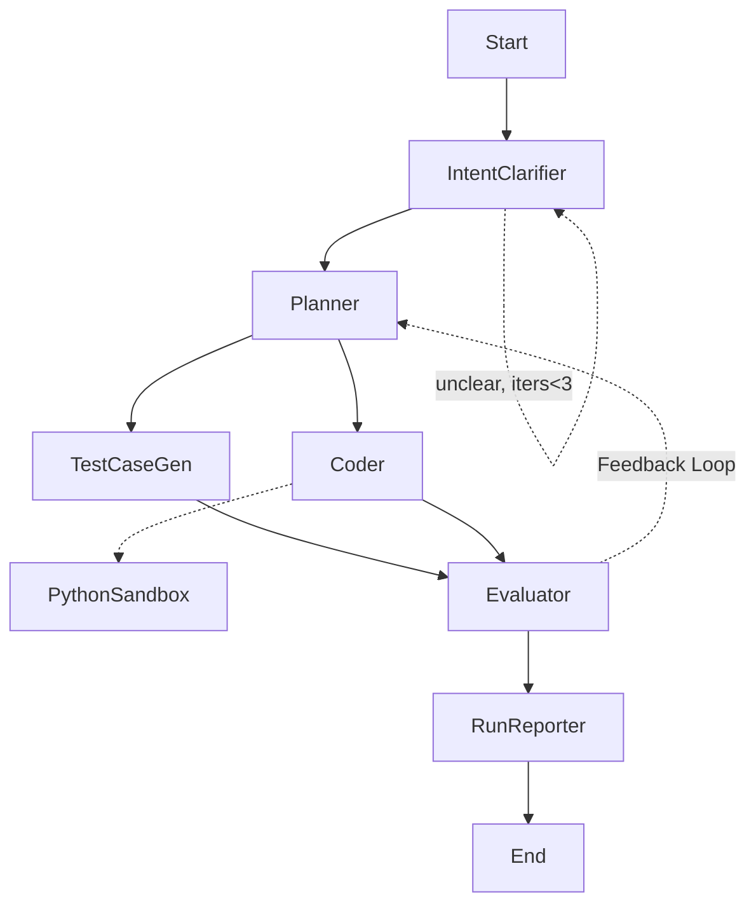

# Agent Architecture — LangGraph DSA Solver

Branch: `task/step-1-5` | Updated: 2026-10-13
Status: Steps 1–9 complete (22 tests green; 3 golden E2Es 5/5 live) + interactive CLI prompt.

## Goal
Terminal-driven LangGraph agent that solves data-structures & algorithms problems,
verifies with generated tests in a sandbox, retries via feedback loop, and writes
`output/run_id_xxxx.json` with requirement, code, test cases.

## Graph
`Start -> IntentClarifier -(self-loop max 3)-> Planner -> [TestCaseGen, Coder] -> Evaluator -> RunReporter -> End`
- `IntentClarifier --unclear & iters<3--> IntentClarifier`, else `--> Planner` (proceeds with assumptions after 3).
- `Evaluator --fail--> Planner` (max 3 iterations), else `--> RunReporter`.
- `Coder -> guardrail.check() -> python_sandbox` tool (fail-closed; blocked never execs). Full spec: `guardrails.md`.

## Models (Ollama)
- Heavy `gemma4:31b-cloud`: Planner, Coder, Evaluator.
- Small `gpt-oss:20b-cloud`: IntentClarifier, TestCaseGen (switched from
  `deepseek-r1:1.5b` — cleaner structured output; thinking stays out of content).
- `src/agent/llms.py`: `get_small()` temp 0 / 4096 tokens / 90s timeout,
  `get_heavy()` temp 0.2 / 180s timeout.
- Env: `OLLAMA_HEAVY`, `OLLAMA_SMALL`, `OLLAMA_BASE_URL` (default `http://localhost:11434`).

## State (`src/agent/state.py`)
`run_id, requirement, clarified_intent, intent_iterations, intent_clear,`
`plan_steps, test_cases, code, coder_smoke{stdout,stderr,error},`
`guardrail_report{allowed,reasons[],checked_at}, fallback_used,`
`execution_results (+add reducer), eval{passed,passed_count,total,feedback},`
`feedback, iterations, output_path`.

## Nodes (`src/agent/nodes.py`)
1. IntentClarifier (small, self-loop max 3): Python-only gate first
   (`check_language` — SQL/Java/etc → `rejected`, straight to reporter);
   else LLM rewrite per iteration (escalating specificity), heuristic
   `is_intent_clear()` score; emits `intent_iterations`, `intent_clear`;
   router exits to Planner when clear or iters>=3.
2. Planner (heavy, small fallback): LLM algo + complexity + steps; consumes
   `feedback` on retry; heavy→small fallback, stub only if both fail.
3. TestCaseGen (small): LLM JSON `[{id,harness,expected}]` (3-5, harness must
   `print(solve(...))`); validated + guardrail-screened; `[]` fallback.
4. Coder (heavy, small fallback + `python_sandbox` tool): LLM code honoring
   the `solve` contract, mandatory guardrail gate + smoke, one repair attempt
   on failure; emits `code`, `coder_smoke`, `guardrail_report`.
5. Evaluator: runs each harness via gated `run_python`, compares stdout to
   expected; emits `execution_results`, `eval` (failure details), `iterations`.
6. RunReporter (deterministic, no LLM): consolidate + write JSON.

Resilience: small 90s / heavy 180s client timeouts; heavy→small fallback sets
`fallback_used` (planner, coder incl. repair); planner→[tests,coder] fan-out is parallel.

## CLI + Output
- `PYTHONPATH=src uv run python -m cli --problem "..." | --file p.md | stdin pipe`.
  With no args on a TTY it prompts via `input()` (blank line finishes); piped stdin still read directly.
- `run_id = run_id_YYYYMMDD_HHMMSS_<6hex>`, overridable via `--run-id`.
- JSON schema: `run_id, timestamp, models{heavy,small}, requirement, clarified_intent,`
  `intent_iterations, intent_clear, plan_steps, test_cases, code, coder_smoke,`
  `guardrail_report, fallback_used, execution_results, eval`.
- Written by RunReporter to `output/<run_id>.json` (also on exhausted retries with `passed:false`).

## Guardrails
Spec: `guardrails.md` (static AST gate + strict file lockdown + hardened exec,
fail-closed). Implementation: `src/agent/tools/guardrail.py` + `tests/test_guardrails.py` (see `plans.md` Step 5).

## Project setup (uv)
- `pyproject.toml`: `langgraph, langchain-ollama, langchain-core, pydantic, rich`; dev `pytest, ruff`.
- Layout: `src/agent/{state,llms,nodes,prompts,graph,tools/sandbox,tools/guardrail}.py`, `src/cli.py`,
  `tests/{test_graph,test_sandbox,test_intent,test_toolbox,test_guardrails,test_nodes,test_cli}.py`, `output/.gitkeep`, `plan/`.
- Verify: `uv sync`, `PYTHONPATH=src uv run pytest -q` (22 passed),
  `PYTHONPATH=src uv run python -m cli --problem "two sum..."`.
